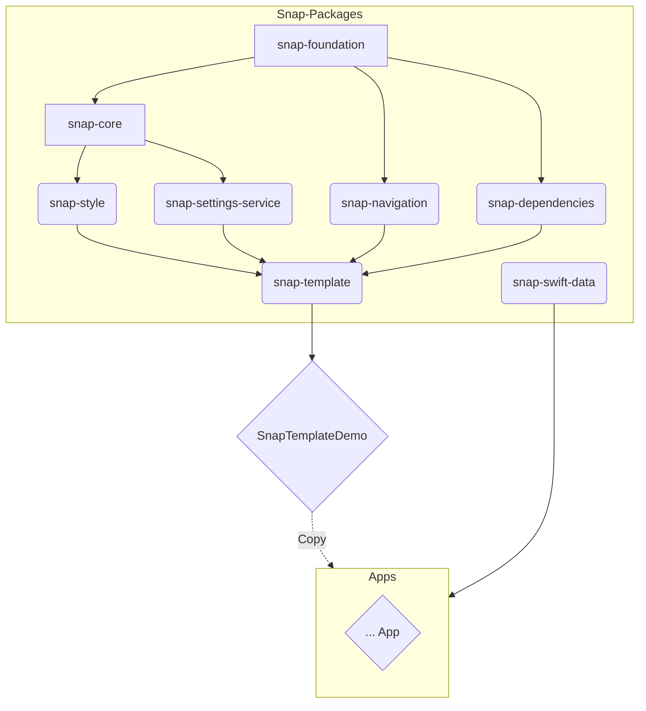

# SNAP - SN App Packages

SNAP is a set of Swift packages I use to build iOS apps. This repository is the overview for the suite. The packages live in their own repositories.

The packages contain shared code and reusable implementations of common app features. [snap-template](https://github.com/simonnickel/snap-template) shows them all together in action and is the starting point for a new app.

The suite is shaped around my own needs, see the [mission statement](./docs/suite/mission-statement.md). It is unreleased, so public API can change at any time.

## Guides

You need rules to break them, so I made up some of my own: [conventions](./docs/conventions/).

Packages are set up as described in [package-template.md](./docs/suite/package-template.md).

Coding agents share instructions and skills across the suite, as described in [agent-setup.md](./docs/suite/agent-setup.md).

Recurring code patterns are collected as examples in [code-reference](./code-reference/).

## Package Dependencies

Mermaid: [Docs](http://mermaid.js.org/intro/), [Editor](https://mermaid.live/)

## Packages

### snap-foundation

[snap-foundation](https://github.com/simonnickel/snap-foundation) contains basic extensions for Swift and Foundation.

### snap-core

[snap-core](https://github.com/simonnickel/snap-core) contains Swift, SwiftUI and UIKit extensions, helper implementations, convenience definitions and workarounds.

### snap-style

[snap-style](https://github.com/simonnickel/snap-style) is a semantic styling system for multi-platform SwiftUI apps. Define visual attributes such as colors, fonts, icons and spacing once, reference them by semantic key paths and apply them in views.

### snap-settings-service

[snap-settings-service](https://github.com/simonnickel/snap-settings-service) stores `Codable` values for `String` keys in `UserDefaults`, `NSUbiquitousKeyValueStore` or a custom store.

### snap-navigation

[snap-navigation](https://github.com/simonnickel/snap-navigation) defines SwiftUI navigation structure separately from presentation. It supports selectable destinations, stack pushes, modal presentation, deeplinks and multiple presentation styles.

### snap-dependencies

[snap-dependencies](https://github.com/simonnickel/snap-dependencies) provides a dependency injection container based on `Dependencies` key paths and a `@Dependency` property wrapper.

### snap-swift-data

[snap-swift-data](https://github.com/simonnickel/snap-swift-data) improves interoperability between SwiftData, CoreData objects and Persistent History Tracking.

### snap-template

[snap-template](https://github.com/simonnickel/snap-template) contains shared code and a demo Xcode project for using SNAP in an iOS app. The demo includes prepared app structure, navigation and infrastructure.

## History

- [snap-app-template](https://github.com/simonnickel/snap-app-template) was moved into [snap-template](https://github.com/simonnickel/snap-template) as its demo project.
- [snap-matching-navigation](https://github.com/simonnickel/snap-matching-navigation) was replaced by [snap-navigation](https://github.com/simonnickel/snap-navigation).
- [snap-theme](https://github.com/simonnickel/snap-theme) was replaced by [snap-style](https://github.com/simonnickel/snap-style).

## Package Collections

Not working at the moment (2026-05)! The Generator does not build, will try again in the future.

`packages.json` is prepared.

[Swift Package Collection](https://www.swift.org/blog/package-collections/)
[Generator](https://github.com/swiftlang/swift-package-collection-generator)